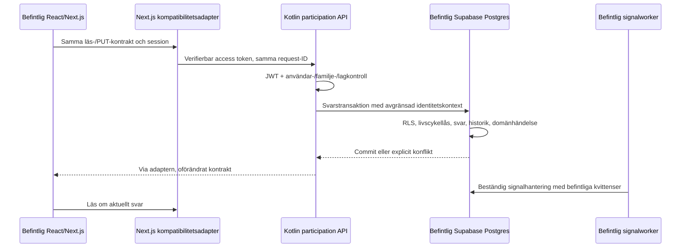

# Första kompletta flödet: besvara en kallelse

Status: föreslaget första verksamhetsflöde, inte implementerat.
Beroenden: M01–M07 enligt [uppgifterna](tasks/README.md).
Beslut: [ADR-003–007](decisions.md). Säkerhetsbas:
[befintlig säkerhetsarkitektur](../security-architecture.md).

## Avgränsat användarresultat

En inloggad person eller målsman öppnar familjens kallelse, ser nuvarande svar,
svarar ja/nej, ändrar eller återställer svaret och ser resultatet efter omladdning.
Utelämnad kommentar bevarar tidigare text. Explicit tom kommentar rensar den;
`pending` rensar kommentar och svarstid. Felaktig, tidig, inställd eller avslutad
kallelse ger samma begripliga fel som i dag. Obehöriga får inga privata uppgifter.

Detta är hela svarskommandot med läsning, behörighet, skrivtransaktion,
historik och befintlig signalreaktion. Skapande/utskick av kallelsen använder
befintlig lösning tills M09/M10. Ingen ny UI-funktion eller kanal införs här.
MCP får inte samtidigt utökas från läsning/utkast till skrivning.

## Konkreta befintliga filer

- `src/components/overview-invitation-response.tsx`: snabbsvar i översikt.
- `src/app/api/invitations/[invitationId]/respond/route.ts` och `.test.ts`:
  PUT, validering, session, läsning, livscykelfel, uppdatering och HTTP-kontrakt.
- `src/app/api/activities/[activityId]/my-invitations/route.ts` och `.test.ts`:
  underlag för familjens egna kallelser.
- `src/data/personal-dashboard.ts`, `src/data/team-dashboard.ts`:
  omgivande läsningar och uppdatering av översikten.
- `src/lib/invitation-availability.ts`, `src/lib/invitation-availability.test.ts`:
  tidigaste svarstid.
- `supabase/migrations/20260923211000_activity_events.sql`: svarshistorik.
- `supabase/migrations/20261008183546_capability_signals.sql`: beständig
  `activity.invitation_response_changed` och signalreaktion.
- `supabase/migrations/20261011231144_lock_completed_invitation_responses.sql`:
  databasens lås mot samtidig inställning/tidsändring.
- `supabase/tests/invitations_rls_test.sql`,
  `supabase/tests/invitation_response_lifecycle_test.sql` och
  `supabase/tests/capability_signals_test.sql`: säkerhets- och regressionsunderlag.

## Första övergången: ny backend, samma primära databas

Next-adaptern hämtar användarens verkliga access token på servern; den skapar
ingen ny användartoken. Backend verifierar token själv. En gemensam databas
innebär ingen datareplikering eller dubbelskrivning. Gamla Telegram-/WhatsApp-
svar fortsätter genom sina befintliga kontroller tills kanalerna flyttas.

M05 ska bevisa att JDBC kan använda en begränsad runtime-roll och
transaktionslokal, serverbyggd claims-kontext utan att kringgå RLS. Poolade
anslutningar måste testas mellan två användare, även efter rollback/timeout.
Använd aldrig klientens JSON eller en databasägarroll som reserv.
M07 aktiveras först när detta och familjens läsning fungerar end-to-end.

Svarets befintliga trigger fortsätter äga historik och signalhändelse. M06:s
Registry-prov får inte publicera en dubblett av den. Det avgör övergången för
kommande Kotlin-ägda reaktioner och målmiljön; det är inget krav att byta alla
befintliga köer för att flytta en endpoint.

## Verifieringsmatris för M07

| Fall | Förväntat resultat |
| --- | --- |
| Egen person; målsman med två barn; ledare med bredare läsåtkomst | Enbart den valda och faktiskt tillåtna kallelsen ändras; läsning av egna svar förblir familjeavgränsad |
| Annat lag, annan klubb, återkallad familje-/rollkoppling | Nekad åtkomst, ingen ändring/historik/händelse och ingen dataläcka |
| Saknad/utgången token, fel issuer/audience/scope eller otillåten grant | Nekat innan verksamhetsåtkomst |
| Ja → nej → pending, explicit/utelämnad kommentar | Samma fält- och tidssemantik som befintligt API |
| Före utskick, inställt, avslutat, samtidig inställning/tidsändring | Atomärt nekande eller korrekt serialiserad skrivning, 409 för livscykelkonflikt |
| Repetition efter timeout eller två samtidiga svar | Dokumenterad ordning och inga extra sidoeffekter för oförändrat tillstånd; äldre kanalkvittenser kan inte skriva över senare svar |
| Commit och krasch före HTTP-svar; rollback; signalworker nere | Svar/historik/händelse förblir konsistenta; beständigt arbete kan återtas |
| Äldre öppen frontendflik, snabbknapp och aktivitetsdialog | Samma URL, request/response och UI-tillstånd; omladdning visar sparat svar |
| Två poolade användare efter fel | Ingen claims- eller rollkontext läcker mellan transaktioner |

Kör JUnit/regler, Modulithstruktur, PostgreSQL/Testcontainers och relevanta
befintliga Vitest/pgTAP-tester samt ett browserflöde med syntetiska användare.
Dokumentera varje faktiskt körd miljö. Enbart mockade HTTP-tester räcker inte.
Ingen notifiering ska skickas bara för att ett svar återspelas. Revisionspost med
konto och kanal tillkommer explicit om nuvarande historik inte räcker; detta
är målkrav och får inte beskrivas som redan implementerat.

## Aktivering, återgång och senare Cloud SQL-flytt

Aktivering är miljöägd serverrouting för dessa endpoints, inte ett klientval av
databaskälla. Dränera gamla anrop och rikta nya anrop till en implementation.
Ingen automatisk skrivfallback efter timeout: resultatet kan redan vara sparat.
Återgång före dataflytt växlar implementation men behåller samma databas och
kontrakt. Kvittera pågående anrop och kontrollera sidoeffekter vid växling.

M12 är nu ett vilande Cloud SQL-alternativ enligt ADR-008; M13 flyttar backendansvar på samma databas. Om separat dataflytt senare beslutas får den ske först när samtliga skrivare till klubbens sammanhängande
data kan stängas av eller ledas till målbackend: aktiviteter, svar, närvaro,
pass, kanalwebhooks, RPC:er, workers och direkt PostgREST från gamla flikar.
Delade identiteter och kataloger behöver separat mappning. Det räcker inte att
kopiera `invitations` medan aktiviteter, behörigheter och cron bor kvar.
Cloud SQL-acceptans kräver samma flöde mot importerade testdata, bevarade UUID,
relationer, historik och leveranskvitton samt övad frysning och återställning.
